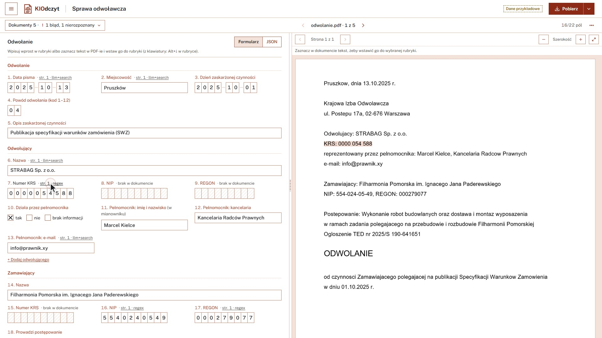
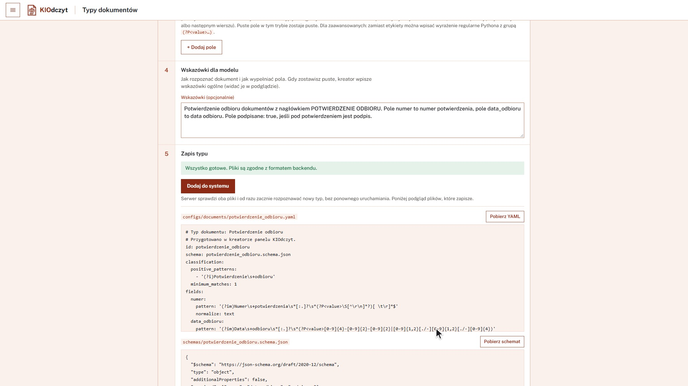

# KIOdczyt (Odwołania2JSON)

**PDF-y sprawy odwoławczej KIO → JSON w formacie Urzędu Zamówień Publicznych.** KIOdczyt rozpoznaje dokument
(odwołanie, pełnomocnictwo, potwierdzenie przelewu albo dokument spoza tych klas), wyciąga dane i zapisuje je do
`output/<sprawa>/<nazwa pliku>.json`. Urzędnik może przejrzeć i poprawić wynik w panelu WWW, gdzie przy każdym polu
widać, skąd pochodzi w dokumencie.

| Test UZP | Walidacja UZP | Inny układ dokumentów | Prawdziwe odwołania z internetu | Model |
|---|---|---|---|---|
| **F1 1,0000** | **F1 1,0000** | **F1 1,0000** | **F1 0,951** (16 pism) | Qwen3.5 9B, open source, UE |

Szczegóły pomiaru, metoda i ograniczenia: [docs/WYNIKI.md](docs/WYNIKI.md). Jak działa program krok po kroku,
od PDF-u do JSON-u: [docs/JAK-TO-DZIALA.md](docs/JAK-TO-DZIALA.md).

**Film z pokazem (1:45):** https://youtu.be/W-GR1I-Tb3c · **Prezentacja (PDF, 10 slajdów):** [docs/prezentacja/KIOdczyt-prezentacja.pdf](docs/prezentacja/KIOdczyt-prezentacja.pdf)

## Prezentacja demo

> [!TIP]
> **Obejrzyj film demonstracyjny:** kliknij miniaturę poniżej, aby obejrzeć go w serwisie YouTube.
>
> [](https://youtu.be/W-GR1I-Tb3c)

## Uruchomienie

**Serwer oceny UZP (Azure VM):** projekt leży w `/opt/solution`, komenda oceny jest w [RUN.md](RUN.md):

```bash
docker compose run --rm batch
```

Instrukcja wdrożenia i testu: [deploy/VM.md](deploy/VM.md).

**Lokalnie (Windows, Python 3.13+):**

```powershell
py -3.13 -m venv .venv
.venv\Scripts\python.exe -m pip install -r requirements.txt
copy .env.example .env      # wpisz klucz po LLM_API_KEY=
.\przetworz.bat             # input\<sprawa>\*.pdf  ->  output\<sprawa>\*.json
.\start.bat                 # panel WWW pod http://127.0.0.1:8000/
```

Na Linuksie: `python3.13 -m venv .venv`, `.venv/bin/python -m pip install -r requirements.txt`, `./przetworz.sh`, `./start.sh`.
`python main.py --rules` działa bez modelu (tryb regułowy z konfiguracji YAML).

## Jak to działa

```
PDF ─► tekst stron (pypdf) ─┬─► model (Qwen3.5 9B): typ + dane wg schematu ─► reguły po modelu (YAML) ─► normalizacja ─► walidacja schematu ─► JSON
                            └─► strony bez tekstu: obraz strony do tego samego modelu
                 błąd usługi modelu po ponowieniach ─► wynik z reguł YAML; dokument spoza klas ─► {}
```

- **Jeden model, jedno zapytanie na dokument.** Prompt [prompts/system_pl.md](prompts/system_pl.md) opisuje rolę
  każdego pola (a nie konkretną etykietę w piśmie), więc działa też przy innym układzie dokumentu.
- **Reguły po modelu** (sekcje `postprocess:` w [configs/documents](configs/documents)) uzupełniają tylko puste pola,
  ujednolicają pisownię imion z dokumentem, wpisują opis powodu ze słownika i rozstrzygają powód odwołania,
  gdy tekst zaskarżonej czynności jest jednoznaczny.
- **Normalizacja i zgodność z UZP:** daty ISO, kwoty jako liczby, rachunek jak w dokumencie (z „PL”),
  numery TED i BZP w formacie wzorców, imiona w mianowniku, dokument spoza klas = plik z samym `{}`.
- **Odporność:** równoległe zapytania (`LLM_CONCURRENCY`), ponawianie błędów 429/5xx, wynik awaryjny z reguł,
  plik wyniku dla każdego PDF-u.

Pełny opis (zapytanie do modelu, reguły po modelu, skany, obsługa błędów, panel i API):
[docs/JAK-TO-DZIALA.md](docs/JAK-TO-DZIALA.md).

## Model i dane

- **Qwen3.5 9B** (Alibaba Qwen, licencja Apache 2.0), dostarczany przez **HostYourAI B.V.** (Holandia),
  przetwarzanie w centrach danych w UE; API zgodne z OpenAI Chat Completions. Ten sam model czyta skany z obrazu,
  więc rozwiązanie używa jednego modelu.
- Konfiguracja w `.env` (wzór: [.env.example](.env.example)): `LLM_API_KEY`, `LLM_BASE_URL`, `LLM_MODEL`,
  `LLM_EXTRA_BODY` (wyłączenie trybu „myślenia”), tempo i ponowienia (`LLM_CONCURRENCY`, `LLM_REQUEST_INTERVAL_SECONDS`,
  `LLM_MAX_429_RETRIES`, `LLM_MAX_RETRY_WAIT_SECONDS`, `LLM_TIMEOUT_SECONDS`), skany (`SCAN_MODE`, `SCAN_MAX_PAGES`).
  Klucza nie ma w repozytorium.

## Nowy typ dokumentu bez zmiany kodu

Typ dokumentu to dwa pliki: `configs/documents/<typ>.yaml` (rozpoznawanie, wskazówki dla modelu, opcjonalne reguły)
i `schemas/<typ>.schema.json` (pola wyniku). Można je dodać ręcznie albo w panelu: menu ☰ → „Typy dokumentów” →
kreator, który zapisuje oba pliki na serwerze; serwer sprawdza je regułami ze startu i od razu zaczyna rozpoznawać
nowy typ, a panel buduje dla niego formularz ze schematu. Sprawdzone na typie „orzeczenie KIO”: 40 prawdziwych orzeczeń, F1 1,0000
([test](docs/eksperymenty/prawdziwe-dane.md)). Opis: [docs/ADD_DOCUMENT_TYPE.md](docs/ADD_DOCUMENT_TYPE.md).



## Panel WWW

Panel (folder [frontend](frontend), bez budowania i zależności) działa pod tym samym adresem co API:
wgrywanie spraw, przetwarzanie plik po pliku, formularz z kratkami, podgląd PDF z podświetleniem źródła pola,
poprawki z cofaniem, wstawianie zaznaczonego tekstu z PDF-u, sumy kontrolne NIP/REGON/PESEL/rachunku,
eksport JSON i ZIP sprawy, kreator typów. Opis: [frontend/README.md](frontend/README.md).
API: `POST /api/extract`, `GET`/`POST /api/document-types` ([kontrakt](docs/INTERFACES.md)).

## Ewaluacja

```powershell
.venv\Scripts\python.exe evaluation\experiment.py --name proba --split validation --data <hacknation-2026>\dane --key-from LLM_API_KEY
.venv\Scripts\python.exe evaluation\evaluate.py --manifest evaluation\manifest.json --data <dane> --predictions <output> --split validation --output raport.json
```

`evaluate.py` liczy F1 według zasad UZP (bez wywołań modelu), `experiment.py` robi pełny przebieg na podziale z
[evaluation/manifest.json](evaluation/manifest.json) i dopisuje wynik do tabeli. Zestaw odporności na inny układ:
`evaluation/layout_variants.py`. Dzienniki rund poprawek: [docs/eksperymenty](docs/eksperymenty).

Testy: `.venv\Scripts\python.exe -m pip install -r requirements-dev.txt`, potem `.venv\Scripts\python.exe -m pytest -q`
(backend) i `node --test frontend/tests/` (panel).

## Struktura repozytorium

| Ścieżka | Zawartość |
|---|---|
| `main.py`, `src/kio_extract/` | CLI, przetwarzanie, klient modelu, reguły, API |
| `configs/documents/`, `schemas/` | typy dokumentów: konfiguracja YAML i schematy JSON |
| `prompts/` | prompt systemowy modelu |
| `frontend/` | panel WWW |
| `evaluation/` | ewaluator, eksperymenty, manifest podziału danych |
| `deploy/`, `RUN.md`, `compose.yaml`, `Dockerfile` | wdrożenie na serwer oceny |
| `docs/` | wyniki, prezentacja, kontrakt, dodawanie typów, dzienniki eksperymentów, [archiwum](docs/archiwum) |
| `tests/` | testy backendu |

Zależności (wszystkie open source, działają na CPU): pypdf, PyYAML, jsonschema, FastAPI, uvicorn, python-multipart,
pypdfium2, Pillow, python-dotenv; panel używa lokalnie PDF.js i fontu Public Sans (OFL).
